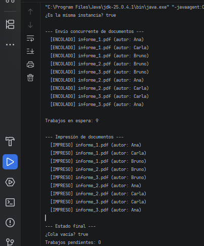

# Ejercicio 7: Cola de Impresión Centralizada

## Descripción

Este ejercicio implementa el patrón de diseño **Singleton** en Java para administrar una cola de impresión compartida por múltiples terminales de una oficina.

La clase `PrintQueue` centraliza el encolado de documentos y su procesamiento en orden de llegada.

## Objetivos

- Aplicar Singleton para coordinar una estructura de datos tipo cola.
- Impedir la creación de instancias adicionales mediante un constructor privado.
- Permitir encolar documentos con metadatos, como el nombre del archivo y el autor.
- Procesar los documentos secuencialmente y eliminarlos de la cola al procesarlos.
- Evitar condiciones de carrera cuando varias terminales envían trabajos simultáneamente.

## Implementación del patrón Singleton

La clase `PrintQueue` utiliza los siguientes elementos:

- **Clase interna `Holder`:** contiene la instancia estática del Singleton.
- **Constructor privado:** impide crear instancias directamente desde otras clases.
- **Método `getInstance()`:** devuelve siempre la misma instancia a través de `Holder`.
- **Método `enqueue()`:** valida que el trabajo no sea nulo y agrega un `PrintJob` al final de la cola.
- **Método `processNext()`:** extrae el documento más antiguo y simula su impresión.
- **Métodos `size()` e `isEmpty()`:** permiten consultar el estado de la cola.
- **Métodos sincronizados:** coordinan el acceso concurrente a la estructura compartida.

La instancia se crea de forma perezosa mediante el *Initialization-on-demand Holder Idiom*. Esto significa que se crea cuando se solicita por primera vez y que la inicialización es segura entre hilos gracias a las garantías de la JVM.

## Propósito de la clase PrintQueue

La clase `PrintQueue` se creó para que todos los documentos pasen por una única cola compartida.

Si cada terminal tuviera su propia cola, no existiría un orden global de procesamiento y sería más difícil coordinar los trabajos enviados por diferentes usuarios.

En este ejercicio, la impresión se simula mediante mensajes en la consola. Cada documento se representa con el `record` `PrintJob`, que contiene el nombre del archivo y el autor.

## Concepto clave

Este ejercicio combina el patrón Singleton con una cola FIFO (*First In, First Out*).

El *Holder Idiom* garantiza una inicialización segura de la instancia única sin necesidad de sincronizar `getInstance()`. Además, los métodos `enqueue()` y `processNext()` son sincronizados y comparten el mismo bloqueo (la instancia), de modo que un solo hilo a la vez puede modificar la cola, ya sea agregando o extrayendo un documento.

El orden de impresión corresponde al orden en que los documentos se incorporan efectivamente a la cola, incluso cuando varias terminales realizan envíos concurrentes.

## Resultado

## Conclusión

Este ejercicio demuestra cómo Singleton permite centralizar una estructura compartida bajo múltiples peticiones concurrentes.

La cola reside exclusivamente dentro de la instancia única, mientras que la sincronización protege sus operaciones frente a accesos simultáneos. 
De esta forma, los documentos se extraen respetando el orden FIFO y se evita que varios hilos extraigan simultáneamente el mismo trabajo.